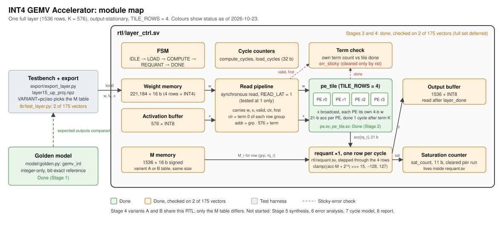

# INT4 GEMV Accelerator

Hi! I'm exploring a hardware design for one calculation an LLM repeats each time it generates a token. It uses 4-bit weights to reduce how much data the design needs to read, and I’m comparing two ways to keep the outputs accurate. More accurately this is a SystemVerilog accelerator for one quantized linear layer of a small open LLM, running single-token decode. Decode turns each token into a matrix-vector product (GEMV), so the work is limited by how fast weights can be read, not by how many multiplies the hardware can do. I tested it on a real SmolLM2-135M layer and checked the results against a Python reference. This project measures how one design choice, the output requantization scheme, changes accuracy, cycles, and area on that workload.

Scope and requirements: [PRD](PRD%20Decode-Time%20INT4%20GEMV%20Accelerator%20Study.md). Stage plan: [docs/PLAN.md](docs/PLAN.md). Decisions and things I didn't expect: [docs/decision-log.md](docs/decision-log.md).

## Module map



## Status

| Stage | What | Status |
| --- | --- | --- |
| 0 | Repo, tooling, fresh-clone check | Done |
| 1 | Frozen spec, integer golden model, error bound | Done. P1 failed on the isolated comparison and is reported as a failed prediction |
| 2 | MAC processing element and 4-row output-stationary tile | Done. Bit-exact in Icarus simulation |
| 3 | Layer controller, requantization, sticky error flag | Done for two vectors. Full 175-vector RTL run deferred |
| 4 | Variant A (per-channel output scale) and B (per-tensor output scale), same RTL | Done for two vectors per variant. Error figures come from the golden model over all vectors |
| 5 | Synthesis with Yosys and OpenROAD | Not started |
| 6 | Error analysis | Not started |
| 7 | Cycle model with read latency | Not started |
| 8 | Report and demo | Not started |

This is a simulation-focused project.

## Background: what GEMV is, and why decode is different

A matrix-matrix product (GEMM) reuses each weight across many inputs, so the cost of reading weights is amortized. Decode is a GEMV: one input vector, one pass over the weights per token. Each weight is used once, so reading weights, not multiplying, sets the speed.


## Design decisions

- **Workload:** one decode-time up-projection, `model.layers.15.mlp.up_proj` of SmolLM2-135M, shape 1536 × 576 [1]. Chosen as the largest MLP matrix in a middle layer.
- **Number format:** INT4 weights with symmetric per-row scales, INT8 activations with one per-tensor scale, signed 21-bit accumulator. Integer-only datapath, with floats only in the reference and the error bound [2, 3].
- **Accumulator width:** 21 bits, from the worst case `576 × 1016 = 585,216`. Prediction P3 (18 bits is enough on real weights) passed in Stage 1: max `|acc|` on calibration is 2,518. The spec keeps 21 bits.
- **Requantization:** fixed-point multiplier `M_r` per row, shift 15, round half up, clamp to [−128, 127] [2]. The golden model in `model/golden.py` is the source of truth.
- **Dataflow:** output-stationary [4]. Each PE keeps one accumulator, so partial sums never move. Activations are broadcast across the tile; a systolic skew is not used because in GEMV one activation feeds every output row.
- **Tile:** 4 output rows, one term per cycle, `done` pulsed one cycle after the Kth term. The driver must assert `clr` on term 0 of each row set. The tile cannot detect a missing `clr` (it silently merges two rows), so a test pins the behavior and the controller catches it with a sticky error flag.
- **Memory:** one-cycle synchronous read in Stage 3. Read latency is a parameter (`READ_LAT`) so Stage 7 can add it without rewriting the controller. Stage 3 cycle counts are compute-only and are not decode latency.
- **Variants:** A and B differ only in the contents of the `M_r` table. Both store 1,536 per-row entries, because `M_r` contains the per-row weight scale, so the expected area difference is small. Stage 5 will check this.
- **Verification:** golden model first, then PE tests, tile tests, and layer tests, all bit-exact. Missing-`clr` and sticky-flag behavior are tested directly. cocotb drives the simulations.

## What requantization is, and what this project compares

A layer's dot products produce large integers. The accumulator for one output row is up to 21 bits wide, but the next layer takes 8-bit inputs. Requantization is the step that maps each accumulator back to an 8-bit output, using a scale for each row:

```
y = clamp( (acc × M_r + 2¹⁴) >> 15, −128, 127 )
```

- `acc` is the 21-bit integer dot product for output row `r`.
- `M_r` is a fixed-point multiplier, a 16-bit integer stored per row. `M_r = round(s_x · s_r / s_out · 2¹⁵)`: the input scale times the row's weight scale, divided by the output scale.
- `>> 15` drops the 15 fractional bits. `+ 2¹⁴` rounds half up before the shift.
- `clamp` limits the result to the INT8 range. Each clipped value is counted as a saturation.

The weights are the same in both variants: INT4 with a scale per row, `s_r = max|w_r| / 7`. The activations use one scale for the whole layer, `s_x = max|x_cal| / 127`, set from the calibration set. What differs is the output scale `s_out`:

- **Variant A, per-channel output scale.** Each row gets its own `s_out_r = max|y_cal_r| / 127`, so each row's float output fills its full INT8 range on the calibration data. That leaves no headroom: quantized-activation error pushes some outputs past 127 even on calibration, and test vectors larger than the calibration maximum clip too.
- **Variant B, per-tensor output scale.** All rows share `s_out = max over all rows / 127`. Rows with smaller outputs use fewer levels, but there is more headroom before clipping.

Both variants store 1,536 `M_r` values. Variant B's values are not the same for each row, because `M_r` includes the per-row weight scale `s_r`. This is why the area difference is expected to be small.

In the RTL, one requant unit is shared across the output rows: `layer_ctrl.sv` feeds it one row at a time during REQUANT. Its saturation counter is 11 bits and resets at the start of each run. The golden model `gemv_int` is the reference the RTL matches bit-for-bit.

Something I predicted in the spec was that per-channel would have lower max error than per-tensor. On the isolated comparison, with weights held fixed, that prediction failed. The clipping from zero headroom explains most of the gap on the test split. This is a finding about this data and this design, not a general statement about which scheme is better.

## Results so far

Stage 4 on the full 175-vector set (118 calibration, 57 held-out test), with error computed by the golden model:

| Variant | Split | Max abs error | RMSE | Saturations |
| --- | --- | --- | --- | --- |
| A per-channel output scale | cal | 0.8116 | 0.0972 | 1084 |
| A per-channel output scale | test | 1.3758 | 0.1043 | 1266 |
| B per-tensor output scale | cal | 0.8003 | 0.0984 | 1 |
| B per-tensor output scale | test | 0.7639 | 0.0999 | 0 |

- Cycles are identical for A and B (223,488 compute, 223,298 load per vector), because the schedule does not depend on `M_r`.
- The spec predicted per-channel would have lower max error than per-tensor (P1). That prediction failed on the isolated comparison. On the test split, B's lower max error is mostly clipping: A saturates 1,266 times and B never does. On the calibration split the 0.812 vs. 0.800 gap is within bootstrap noise.
- RMSE is mixed: A is lower on calibration, B on test, within about 5%.
- These results do not show that per-channel requantization is better. They show what this design and this data produce. Full logs: `results/stage4_layer_pc.log`, `results/stage4_layer_iso.log`, table in `results/stage4_variants.md`.

## Layout

```
rtl/      SystemVerilog sources (pe, pe_tile, requant, layer_ctrl)
tb/       cocotb testbenches and helpers
model/    Python golden model, float reference, comparison script
export/   weight and activation export scripts
synth/    synthesis scripts and constraints (Stage 5)
results/  generated tables, plots, and logs (scripted output only)
docs/     plan, design docs, decision log
```

## Setup

Python 3.12 is required. The pinned torch 2.5.1 has no Python 3.14 build, so a newer default Python will fail to install. A simulator is also needed: Icarus Verilog is the default. `make test SIM=verilator` runs the smoke test under Verilator. The PE, tile, requant, and layer targets are Icarus only for now. Icarus is tested on Linux (WSL).

```bash
python3.12 -m venv .venv
source .venv/bin/activate        # Windows: .venv\Scripts\activate
pip install -r requirements.txt
make test
```

## Commands

| Command | What it does | Status |
| --- | --- | --- |
| `make test` | Runs the cocotb smoke test | Stage 0 |
| `make export` | Exports the pinned SmolLM2 layer's weights and activations to `export/out/` (needs the model in the Hugging Face cache or network access) | Stage 1 |
| `make golden` | Runs the golden check and writes `results/stage1_golden.log` | Stage 1 |
| `make test-pe` | PE cocotb tests: 84 cases, corner grid, worst case, random, hold | Stage 2, Icarus only |
| `make test-tile` | Tile tests: random, done and hold, idle gaps, sampled real-layer rows on both splits, missing-`clr` contract. Needs `make export` first | Stage 2, Icarus only |
| `make test-requant` | Requant tests against `gemv_int`: formula, accumulator and M extremes, random, saturation counter | Stage 3, Icarus only |
| `make test-layer` | Full-layer test on two vectors (`x_cal_int[0]`, `x_test_int[0]`), every row bit-exact, term stream checked on every term, repeat-from-reset. Needs `make export` first. About 4 minutes | Stage 3, Icarus only |
| `make test-layer-sticky` | Sticky-error test against a copy of the control that drops `clr` on group 1 | Stage 3, Icarus only |
| `make test-layer-noflag` | Mutant check: the sticky test must fail with the error flag disabled | Stage 3, Icarus only |
| `make test-layer-iso` | Same as `make test-layer` with the Variant B `M_r` table (per-tensor output scale). Needs `make export` first. About 4 minutes | Stage 4, Icarus only |
| `make test-layer-full` | All 175 vectors, run once and logged | Stage 3, **not run, deferred** (about 4 hours) |
| `make results` | Regenerates tables, plots, and logs | Stage 6 (not implemented) |

### Full regression

Run from a clean checkout, in this order:

```bash
make export       # only if export/out/ is missing; the .npz is git-ignored
make golden
make test
make test-pe
make test-tile
make test-requant
make test-layer
make test-layer-sticky
make test-layer-noflag
make test-layer-iso
```

`make test-layer-full` is not part of the regression. It is deferred until there is a faster run path.

## References

1. Hugging Face SmolLM2-135M model card and revision pinned in `export/export_layer.py`. https://huggingface.co/HuggingFaceTB/SmolLM2-135M
2. Jacob, B. et al. *Quantization and Training of Neural Networks for Efficient Integer-Arithmetic-Only Inference.* CVPR 2018. https://arxiv.org/abs/1712.05877
3. Krishnamoorthi, R. *Quantizing deep convolutional networks for efficient inference: A whitepaper.* 2018. https://arxiv.org/abs/1806.08342
4. Sze, V. et al. *Efficient Processing of Deep Neural Networks: A Tutorial and Survey.* Proceedings of the IEEE, 2017. https://arxiv.org/abs/1703.09039

## License

MIT. See [LICENSE](LICENSE).

## TL;DR

- **What:** a SystemVerilog accelerator for one decode-time LLM layer (SmolLM2-135M, 1536 × 576, INT4 weights, INT8 activations).
- **Why:** decode is a GEMV, so the limit is reading weights, not multiplying. This project builds the hardware for that workload and records what it costs.
- **Built so far:** the golden model, the PE and 4-row tile, the layer controller, and the requant unit. All bit-exact in Icarus simulation, on two vectors for the full layer.
- **Requantization, the design choice I compared:** each row's 21-bit sum is scaled back to INT8 by a per-row multiplier `M_r`. Variant A uses a scale per row, B uses one for the whole output. Weights are identical.
- **Result:** the per-channel prediction failed. On held-out data, per-tensor has lower max error, mostly because per-channel rows clip with no headroom. RMSE is close. No claim that either is better.
- **Not done:** the full 175-vector RTL run, synthesis, error analysis, the cycle model with read latency, and the report.
- **Simulation only.** No board, no synthesis numbers yet.
