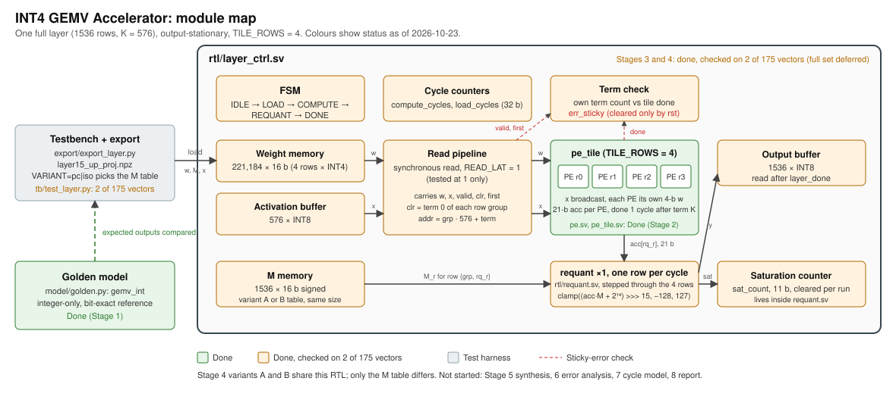

# Inside the INT4 GEMV accelerator

This is a self-directed hardware study built around one operation from a language model. Given the input to one linear projection for one token, the accelerator computes 1,536 outputs from 576 input values. The project starts with a Python description of the arithmetic, builds it into clocked SystemVerilog, and uses the resulting design to study one choice about how to represent the outputs.

- [The problem and research question](#1-the-problem-and-research-question)
- [A dot product you can do by hand](#2-a-dot-product-you-can-do-by-hand)
- [From floating point to integer codes](#3-from-floating-point-to-integer-codes)
- [How the RTL runs one vector](#4-how-the-rtl-runs-one-vector)
- [How the design took shape](#5-how-the-design-took-shape)
- [What the evidence shows](#6-what-the-evidence-shows)
- [Where to start in the repo](#7-where-to-start-in-the-repo)

## 1. The problem and research question

During autoregressive **decode**, the model processes a token to help predict the next one. A linear projection in that step takes one vector of activations, the values coming from earlier computation, and multiplies it by a weight matrix. This is a **general matrix–vector multiply**, or GEMV. In a matrix–matrix multiply (GEMM), several input vectors can reuse a weight after it has been fetched. With one vector, each weight contributes to one multiply–accumulate per pass. If those weights have to be streamed from a slower memory, delivering them can limit throughput even with spare arithmetic capacity.

The workload is `model.layers.15.mlp.up_proj` from SmolLM2-135M. The **up-projection** expands a token's 576-value hidden representation to 1,536 values inside the model's feed-forward block. The design boundary is this one projection. The exporter collects the projection's real inputs during forward passes on fixed prompts, and the accelerator processes each captured vector separately. This setup gives the study realistic layer data while keeping the hardware small enough to build and verify in steps. The model revision, layer path, and sample counts are recorded in the [export manifest](../export/out/manifest.json).

**Research question.** For this layer, what changes in numerical error, clipping, cycle count, and hardware cost when each output row gets its own scale versus when all outputs share one scale? The comparison holds the weight codes, input codes, tile, and schedule fixed. The original [project brief](../PRD%20Decode-Time%20INT4%20GEMV%20Accelerator%20Study.md) sets the broader goals, including synthesis area and maximum clock frequency. The current measurements cover arithmetic and simulation cycles. A realistic memory system would be needed to measure the effect of weight delivery on decode latency.

## 2. A dot product you can do by hand

Think of each row of the matrix as a recipe for one output. Multiply each weight in that row by its matching input, then add the products. In this small example, `x` has three entries and the matrix has two rows. The numbers are already integer codes.

```text
x     = [ 2, -1, 3 ]
row 0 = [ 1, -2, 3 ]   →   2×1 + (-1)×(-2) + 3×3 = 13
row 1 = [-1,  2, 0 ]   →   2×(-1) + (-1)×2 + 3×0 = -4
```

In software you could loop over rows. In hardware, give each row its own **processing element** (PE) and send the same input to both at once. A PE performs a **multiply–accumulate** (MAC) and keeps the running sum in a register called an **accumulator**. A register captures its next value at a clock edge and holds that value between edges. **Register-transfer level** (RTL) describes this movement of data between registers and the logic that calculates the next values.

| Accepted term | Shared input | Weights for rows 0 and 1 | `clr` | Accumulators after the rising edge |
| --- | ---: | --- | ---: | --- |
| 0 | `2` | `1`, `-1` | 1 | `2`, `-2` |
| 1 | `-1` | `-2`, `2` | 0 | `4`, `-4` |
| 2 | `3` | `3`, `0` | 0 | `13`, `-4` |

On the first valid edge, `clr` loads the first product into the accumulator, replacing any previous sum. On later valid edges the PE adds. If `in_valid` is low, the PE holds its sum even if the input wires change. Keeping each partial sum in the same PE until its dot product finishes is called **output-stationary** dataflow. The real design uses four PEs and 576 terms per group. It sends the same input vector again for each successive group of four rows.

## 3. From floating point to integer codes

### What a scale does

Quantization represents a real number with a small integer code `q` and a scale `s`. The scale is the size of one step in real units. The code comes from rounding `value / s` and clamping it to the permitted range. Multiplying `q` by `s` gives an approximation of the original value. With a fixed number of codes, a smaller step can preserve finer differences but reaches its endpoint sooner.

The [exporter](../export/export_layer.py) does the floating-point work before simulation. It captures 118 token vectors from eight calibration prompts and 57 from four separate test prompts. **Calibration** uses example data to choose scales. The held-out inputs use those same scales without refitting them.

| Quantity | Representation | How its scale is chosen |
| --- | --- | --- |
| Weight | Signed INT4 code `q_w` | Each weight row gets `s_w[r] = max(abs(weights in row r)) / 7`. The max-based exporter uses codes from −7 through 7, and the PE accepts the full signed INT4 range, −8 through 7. |
| Activation | Signed INT8 code `q_x` | One scale `s_x = max(abs(calibration inputs)) / 127`. The exporter clips to −127 through 127. |
| Output | Signed INT8 code `y_code` | Calibration float outputs determine `s_out`. Variant A uses one scale per row. Variant B uses one for the entire output vector. |

### Why the sum needs more bits

Each integer product has magnitude at most `127 × 8 = 1,016` under the PE's input contract. A signed 11-bit product covers −1,024 through 1,023. The value −128 fits on the activation wire but is outside this contract. Paired with −8 it would produce +1,024, beyond the product's positive limit.

If 576 products all have the largest magnitude and the same sign, the accumulator must cover `576 × 1,016 = 585,216`. A signed 20-bit register tops out at 524,287. A signed 21-bit register tops out at 1,048,575. The calibration maximum was 2,518, which answers a question about these observed inputs. The hardware width comes from the input contract and the worst case. [Integer specification and predictions](design/01-spec-golden.md)

### How requantization turns the sum into an output

An accumulator is in units of `s_x × s_w[r]` because it sums products of input and weight codes. To express it in output steps, divide by `s_out[r]`. The exporter folds that conversion into one signed 16-bit multiplier for each row. The RTL multiplies by that integer and divides by `2^15` with a shift.

```text
M[r]    = round_to_nearest_even((s_x × s_w[r] / s_out[r]) × 2^15)
rounded = (acc × M[r] + 2^14) arithmetic_shift_right 15
y_code  = clamp(rounded, -128, 127)
```

The first line rounds when creating the multiplier offline. The second line rounds the scaled accumulator in hardware. Adding `2^14` before the signed shift gives nearest rounding with ties toward positive infinity, including for negative values. For the toy example, `M = 16,384` represents a factor of one half. The raw sums `13` and `−4` become `7` and `−2`. With the same factor, `−3` becomes `−1`. If the rounded result is 130, the output is 127 and the hardware records one **saturation**. A rounded result of exactly 127 already fits and records none.

| Choice | A · Per-channel output | B · Per-tensor output |
| --- | --- | --- |
| Calibration rule | Each row's maximum absolute float output divided by 127 | The maximum across all calibration vectors and rows divided by 127 |
| Trade-off | Each row gets finer or equal steps, with little room beyond its own calibration range | Smaller rows can have more room before clipping, with coarser or equal steps |
| Data loaded into RTL | `m_pc` | `m_iso` |

The row is the output **channel** here. The output **tensor** is the collection of all output channels. Both cases load 1,536 multipliers because `s_w[r]` still varies by row. The RTL uses the same memory and requantization unit for both. For numerical evaluation, Python converts the result back to approximate real units with `y_code × s_out[r]` and compares it to the floating-point projection. [Integer model](../model/golden.py) · [Variant implementation](design/04-variants.md)

## 4. How the RTL runs one vector



### What lives where

| Module | What to look for in the source |
| --- | --- |
| [`pe.sv`](../rtl/pe.sv) | Signed operands are widened before multiplication. `always_ff @(posedge clk)` updates one accumulator when `in_valid` is high. |
| [`pe_tile.sv`](../rtl/pe_tile.sv) | A `generate` loop instantiates four PEs that operate in parallel. All see the same `x`. Each sees its own signed four-bit slice of `w`. The tile counts valid terms and registers `done` on the final term's edge. |
| [`requant.sv`](../rtl/requant.sv) | Combinational logic multiplies, rounds, and clamps. A clocked 11-bit counter tracks clipped rows for the run. The 40-bit product path has room for the signed product and rounding addition. |
| [`layer_ctrl.sv`](../rtl/layer_ctrl.sv) | The top module owns the memories, read pipeline, state machine, output writes, cycle counters, and error flag. It reuses one tile across 384 groups and one requant unit across all rows. |

In `layer_ctrl`, a **finite-state machine** (FSM) selects what the hardware does on each cycle. A rising edge with `start` in `IDLE` moves it into `LOAD`. The testbench writes weights, multipliers, and activations, then pulses `load_done`. The controller alternates `COMPUTE` and `REQUANT` for each group. After the last group, `DONE` asserts `layer_done` for one cycle. The testbench reads the results by setting `out_raddr` and observing `out_rdata`. Reset initializes control state and counters. Each run loads fresh memory contents, and the first valid term of each group initializes the PE sums.

| Memory | Contents per run | Access pattern |
| --- | --- | --- |
| `w_mem` | 221,184 words × 16 bits | One word per group and input position, read in order during compute |
| `x_mem` | 576 × 8 bits | The same vector is read from the beginning for each row group |
| `m_mem` | 1,536 × 16 bits | One multiplier per output row, selected during requantization |
| `out_mem` | 1,536 × 8 bits | One result written each `REQUANT` cycle, read by address after completion |

The weight word at address `g × 576 + t` stores column `t` from global rows `4g` through `4g + 3`. For group `2`, term `7`, address `1159` carries weights from rows 8 through 11. Bits `[3:0]` go to the first PE, bits `[7:4]` to the second, and so on. Each PE receives activation `x_mem[7]` for that word. The [testbench loader](../tb/layer_helpers.py) packs these words from the matrix and the tile unpacks them.

### Follow the clock through one group

At `READ_LAT = 1`, a rising edge captures the requested weight word and activation in pipeline registers. The same edge registers `valid`, `clr`, and the intended first-term marker so that the control bits travel with the data. On the following rising edge, the tile consumes those registered values while the memory path captures the next term. Once the pipeline is filled, it delivers one term per cycle.

| Edge or interval | What happens |
| --- | --- |
| First issue edge | Register the reads for term 0, with `valid = 1` and `clr = 1`. |
| Next edge | The tile accepts term 0 and loads the four first products. The memory path registers term 1. |
| Final issue edge | Register term 575 while the tile consumes term 574. |
| One edge later | The tile accepts term 575. The four sums become final, and the registered `tile_done` and `expect_done` signals become high for the following cycle. |
| Next edge | The controller sees `expect_done` and enters `REQUANT`. |
| Next four edges | One row at a time goes through `requant`, and its result is written. The fourth write advances to the next group or to `DONE`. |

One failure is particularly easy to miss when reading the code. If `clr` is missing on the first term of the next group, the PE adds onto the previous group's result, and the tile counter continues from the old group. The controller tracks the expected boundary from a separately pipelined first-term marker. A mismatch between `tile_done` and `expect_done` latches `err_sticky` until reset. The controller advances on its own expected completion, so the failing run can finish and expose the flag. This check covers a completion mismatch. The testbench also monitors the exact activation, packed weight, and `clr` on each valid term. [Controller specification and fault tests](design/03-control-memory.md)

### What a cycle count includes

For the tested read pipeline, each of the 384 groups uses 576 issue cycles, two cycles to accept the last term and observe completion, and four cycles to requantize and write. That gives `384 × (576 + 2 + 4) = 223,488` compute cycles. The testbench loads one item per cycle and measures `221,184 + 1,536 + 576 + 2 = 223,298` load cycles, including two handshake cycles. Both counts are the same for A and B because the sequencer never branches on the multiplier values.

The matrix alone contains 884,736 weights, or 442,368 bytes when packed at four bits each. That is the weight payload for one pass if weights must be fetched from external memory. The simulation loads it through testbench ports and then serves the tile from an idealized synchronous read path. Its load count describes that testbench protocol, and the compute count describes the resulting schedule. Predicting deployed latency would require a clock frequency and a model of how an actual memory system sustains weight delivery, including stalls and any overlap with compute. [Saved simulation results](../results/stage4_variants.md) · [Planned cycle model](design/07-cycle-model.md)

## 5. How the design took shape

1. **Start with one layer and one experimental variable.** I chose SmolLM2-135M to keep export and iteration manageable. A middle-layer up-projection supplied a concrete matrix and real activation vectors. I considered comparing dataflows or accumulator widths, then chose output scales because their effect on individual rows and outliers could be tested directly.
2. **Write the numerical contract before the RTL.** I fixed the input range, accumulator width, rounding, and saturation rules in the spec. The Python golden model is an executable description of those rules. It gives each hardware block something concrete to match and keeps arithmetic mistakes separable from controller mistakes.
3. **Get one PE right, then reuse it.** The first hardware milestone was one signed MAC that handles corner values and holds its state through idle cycles. The tile then introduced broadcast, packing, and a completion signal. A weight-stationary layout would keep weights local and route partial sums. Both layouts still need the full set of weights for one vector. Output-stationary made it possible to keep each wide partial sum local while sharing one input across the tile. Four rows was the size retained at the project gate after the tile tests passed. [PE and tile design](design/02-pe-array.md)
4. **Give the integration failures their own tests.** A missing `clr` silently contaminated the next group in the standalone tile. That became an explicit driver contract and then a controller check. The fault test drops the clear on a generated copy of the controller and checks that the flag is set, stays set through idle, and clears on reset. The no-flag target runs the same assertion against a separate copy with flag-setting disabled and expects it to fail. The final controller writes during `REQUANT` and shares one unit across four rows, so the cycle budget includes the four serial writes.
5. **Correct the comparison when it answers the wrong question.** My first comparison changed both the weight scale and the output scale. Its apparent support for P1, the prediction that per-channel output would reduce maximum error, could have come from either change. I amended the spec with a comparison that holds the weight codes fixed and swaps only the output multiplier table. P1 failed on the isolated comparison. I kept the headroom experiment as a diagnostic and reported the result using the original scaling rules.

The [decision log](decision-log.md) records the choices and revisions in order. The [amended numerical spec](design/01-spec-golden.md) preserves the original comparison alongside the isolated one.

## 6. What the evidence shows

Two different comparisons answer two different questions. **Bit-exact verification** asks whether the RTL produces the same integer codes as Python. **Numerical evaluation** asks how far those quantized outputs are from the float layer. For each variant, the recorded RTL tests check all 1,536 rows on `cal0` and `test0`, compare the saturation count, monitor every issued term, and repeat the first vector from reset. The Python model evaluates all 175 vectors. [Variant A simulation](../results/stage4_layer_pc.log) · [Variant B simulation](../results/stage4_layer_iso.log)

| Output scale | Split | Maximum absolute error | RMSE | Saturations |
| --- | --- | ---: | ---: | ---: |
| A · Per-channel | Calibration (118 vectors) | 0.8116 | 0.0972 | 1,084 |
| A · Per-channel | Held-out test (57 vectors) | 1.3758 | 0.1043 | 1,266 |
| B · Per-tensor | Calibration (118 vectors) | 0.8003 | 0.0984 | 1 |
| B · Per-tensor | Held-out test (57 vectors) | 0.7639 | 0.0999 | 0 |

Maximum absolute error reports the single largest difference in a split. RMSE, or root mean square error, summarizes the differences across all rows and vectors in the split. Both are in dequantized output units. Saturations count individual outputs clipped by requantization, summed across the split. [Results table](../results/stage4_variants.md) · [Evaluation code](../model/check_golden.py)

### Where the error enters

The float projection starts with the original weights and activations. Converting both to integer codes changes the dot product before requantization begins. A and B share that error because they share those codes. The outputs can then differ through the approximation in `M[r]`, the rounding to an INT8 step, and clipping when the rounded code falls outside the representable range. The Stage 1 check found zero violations of the spec's error bound on this export. The bound is a check on the observed errors, and the A/B comparison asks which scales produced smaller errors on the same inputs. [Stage 1 check log](../results/stage1_golden.log)

With per-channel scaling, each row's largest **float** calibration output is placed at the edge of the symmetric scale. Quantizing weights and inputs changes the dot product, so some outputs exceed the INT8 limits even on calibration vectors. Held-out outputs can also exceed the observed calibration range. In the held-out split, 87 of the 100 largest per-channel errors were saturated. The shared scale gave smaller rows more room and had zero held-out saturations in this export. The calibration max-error gap is small enough that the recorded bootstrap interval crosses zero, and RMSE favors different schemes on the two splits. These results describe this layer, these prompts, and these scale rules. [Calibration and clipping diagnostics](design/01-spec-golden.md)

The full 175-vector RTL regression is deferred. **Synthesis** maps the RTL to hardware cells so the study can estimate area and, with timing analysis, the maximum clock frequency. Both variants load the same RTL structure, including the multiplier table, so synthesis characterizes that shared design. The remaining work in the [stage plan](PLAN.md) covers synthesis, deeper error attribution by row and magnitude, and a more realistic cycle model.

## 7. Where to start in the repo

1. Read [`model/golden.py`](../model/golden.py) and follow the toy example through `raw_acc` and `gemv_int`. The first stops at the dot product. The second includes rounding, clipping, and the saturation count.
2. Read [`rtl/pe.sv`](../rtl/pe.sv) alongside [`tb/test_pe.py`](../tb/test_pe.py). Watch `in_valid`, `clr`, and `acc` in the [saved PE waveform](img/pe_waveform.png). After the [README setup](../README.md#setup), `make test-pe` exercises this block without downloading model data.
3. Open [`rtl/pe_tile.sv`](../rtl/pe_tile.sv) and find the generate loop, the weight slice, and the term counter. Then open [`rtl/layer_ctrl.sv`](../rtl/layer_ctrl.sv) and follow one address from `addr_now` through `t_w` to the tile, then one accumulator through `rq_acc` to `out_mem`.
4. To repeat the numerical comparison, run `make export` and `make golden`. The export needs the pinned model in the local cache or access to download it. After export, `make test-layer` and `make test-layer-iso` run the two routine RTL comparisons. See the [command list](../README.md#commands) for individual checks and the [stage documents](PLAN.md#stages) for the original design notes.
